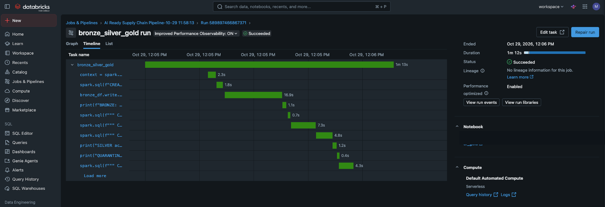
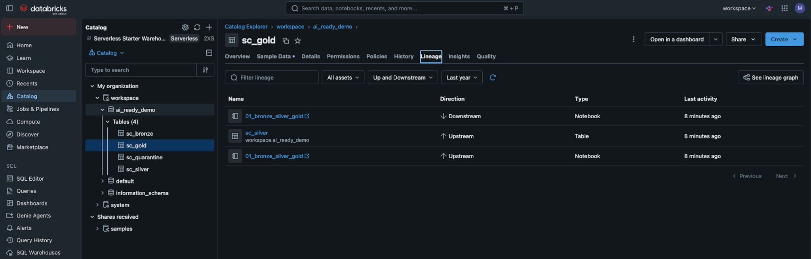
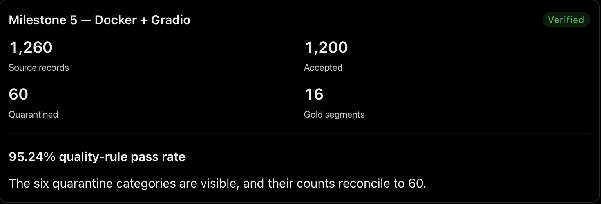
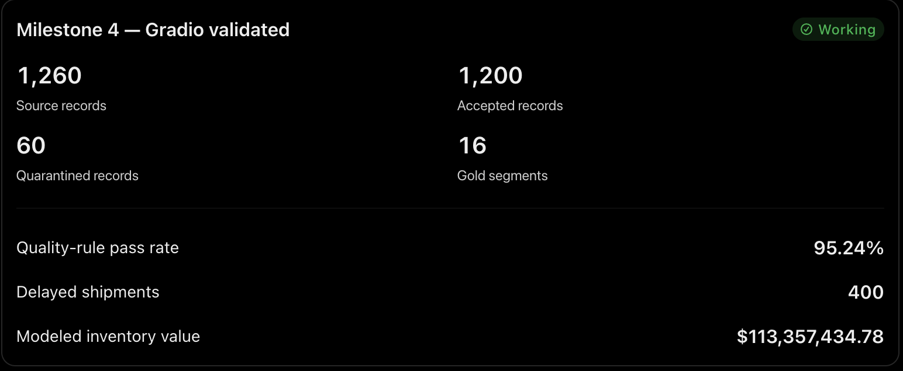
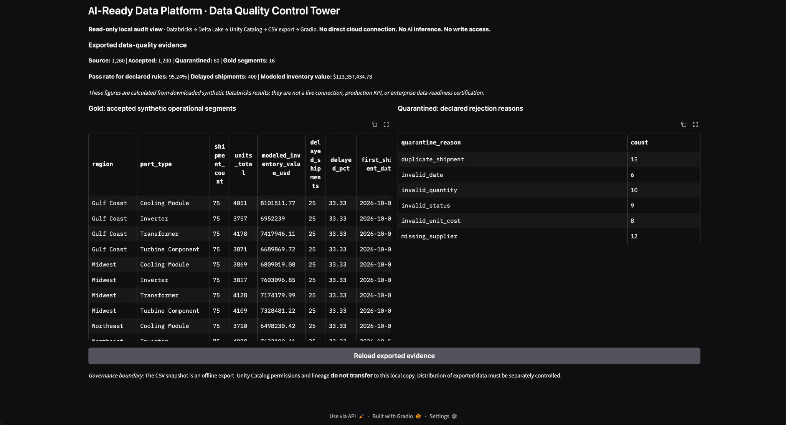
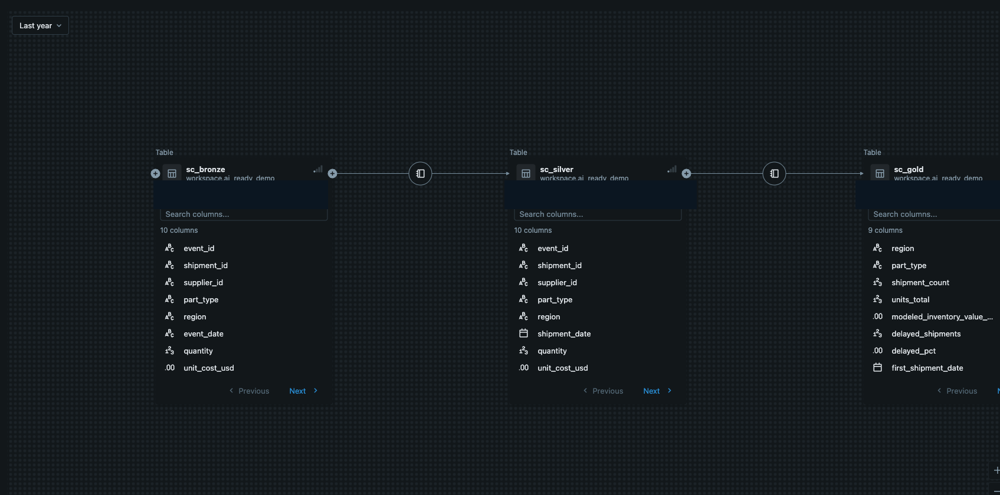
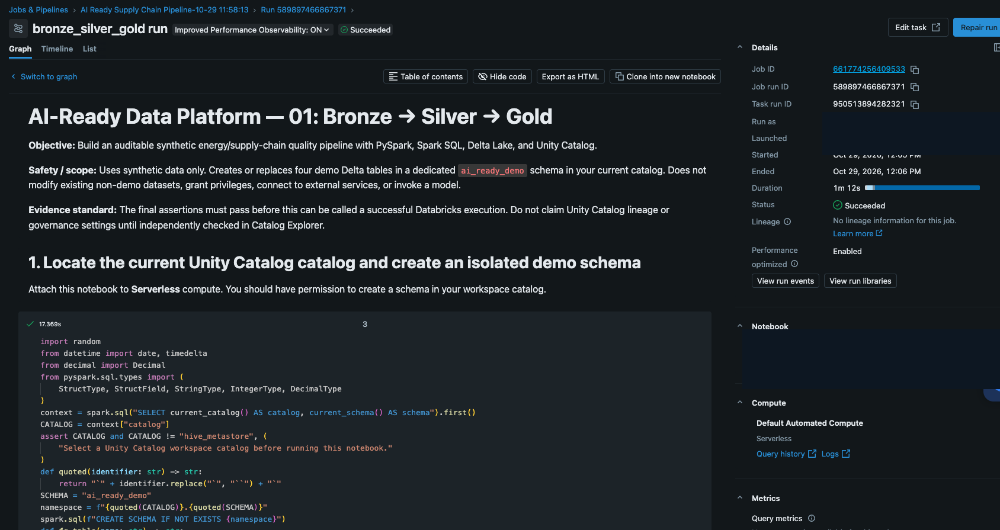
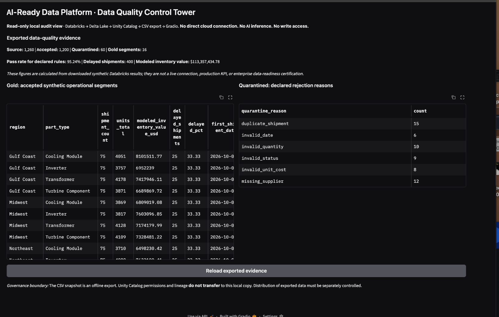
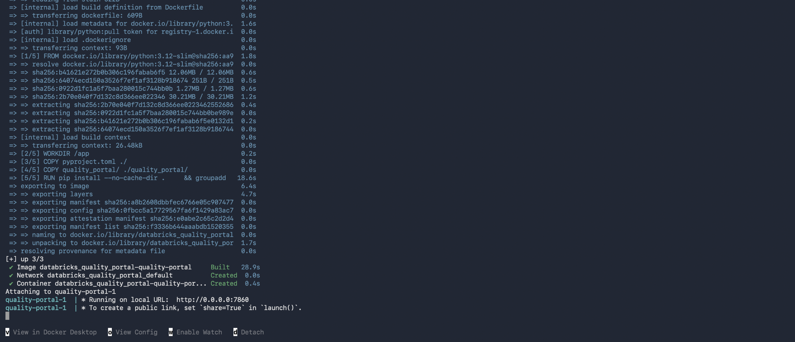
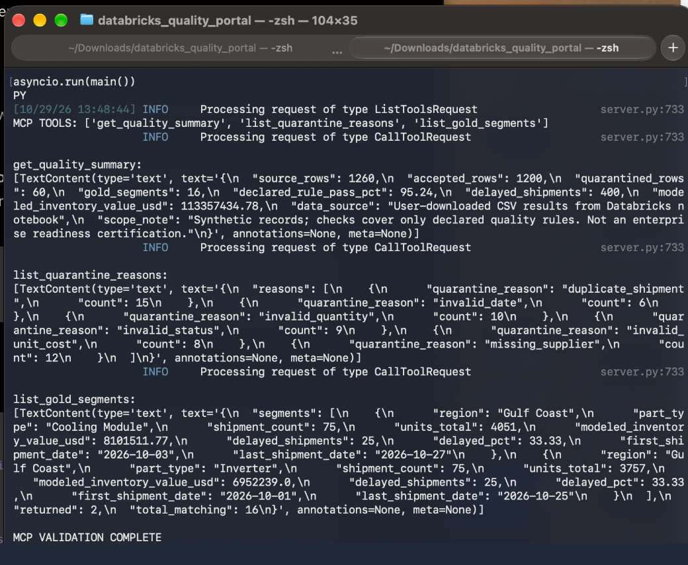

# AI-Ready Data Platform
### Databricks Lakehouse • Governed Data Quality • Read-Only AI Interfaces

**From synthetic enterprise data to validated, traceable, AI-ready business evidence.**

An end-to-end demonstration integrating **Python, Spark SQL, PySpark, Delta Lake, Databricks serverless Jobs, Unity Catalog lineage, Docker, Gradio, and Model Context Protocol (MCP)**. This project turns quality rules into observable data products, then makes the results available through a bounded offline interface.

**Build it. Secure it. Test it. Prove it.**

> **Published reference implementation.** The notebook and local interfaces are independently reproducible; see the measured evidence below and [`PUBLISH.md`](PUBLISH.md) for release workflow notes.


## Demonstrated capabilities

| Skill | Implemented proof |
|---|---|
| **Python** | Modular quality-report loader with six passing offline tests |
| **SQL** | Spark SQL validation, quarantine logic, and Gold aggregation |
| **Apache Spark / PySpark** | DataFrame creation, write operations, and table assertions on Databricks serverless compute |
| **Delta Lake** | Four persisted demo Delta tables |
| **Databricks** | One **successful managed serverless Job** (manual run, 1m 12s) |
| **Governance** | Quality rules, quarantine records, and observed Unity Catalog table-level lineage |
| **Docker** | Image built; local Gradio dashboard launched and populated within the container |
| **Gradio** | Read-only dashboard rendering exported Gold and rejection summaries |
| **MCP** | Stdio server with three discovered and successfully invoked read-only tools |

> **Scope:** This is a working **synthetic-data reference implementation**, not a production deployment or an enterprise security certification. Unity Catalog lineage was observed; fine-grained access enforcement was **not** tested. The local interface uses CSV exports rather than a live Databricks connection.

## The verified outcome — October 29, 2026

| Quality check | Observed |
|---|---:|
| Synthetic raw shipment records | **1,260** |
| Accepted into Silver | **1,200** |
| Quarantined with reasons | **60** |
| Unique accepted shipment IDs | **1,200** |
| Gold region × part segments | **16** |
| Declared quality-rule pass rate | **95.24%** |
| Delayed shipments in Gold | **400** |
| Modeled inventory value | **$113,357,434.78** |
| Automated local tests | **6 passed** |
| Managed Databricks job | **Succeeded**, 1m 12s |
| MCP smoke test | **3 tool calls succeeded** |

Quarantine reason counts were: **15 duplicate shipment, 12 missing supplier, 10 invalid quantity, 9 invalid status, 8 invalid unit cost, 6 invalid date**. These are deliberately injected synthetic errors, not measured enterprise data-quality rates. Gold *modeled inventory value* is quantity × synthetic unit cost, **not** booked revenue or financial reporting.

### Additional release screenshots — October 29, 2026

These screenshots show the observed results of a synthetic-data reference implementation, not a production deployment.

#### Successful managed job timeline


#### Unity Catalog table-level lineage


#### Docker and Gradio milestone


#### Gradio data quality metrics


#### Read-only data quality control tower


> The dashboard reads downloaded CSV snapshots, not a live Databricks connection. Exported files do not inherit Unity Catalog permissions.

## Actual engineering evidence

### 1 · Delta lineage: Bronze → Silver → Gold



*Databricks Catalog Explorer showed the full upstream chain. Cropped and account identifiers redacted for public sharing; source table relationships are unchanged.*

### 2 · Managed Databricks execution



*Single manual workflow run finished **Succeeded** on serverless compute after **1m 12s**. A recurring schedule was **not** configured.*

### 3 · Human-facing quality control tower



*Working read-only Gradio dashboard fed by two manually downloaded CSV reports, not a live governed Databricks connection.*

### 4 · Reproducible local container



*Docker Compose built the image and started the local Gradio server. The owner also observed a populated dashboard after container launch.*

### 5 · Bounded MCP protocol



*Three tools discovered and called using a real MCP client session: quality summary, quarantine reasons, and two sample Gold segments.*

See [the validation matrix](docs/VALIDATION.md), [architecture](docs/ARCHITECTURE.md), and [security boundaries](docs/SECURITY.md) for source/claim distinctions and limitations.

## Reproduce the Databricks pipeline

1. Import [`notebooks/01_bronze_silver_gold.ipynb`](notebooks/01_bronze_silver_gold.ipynb) into Databricks Free Edition (or another compatible Unity Catalog workspace).
2. Select a Unity Catalog catalog where you may create a demo schema and attach **Serverless** compute.
3. Run the notebook. It creates/replaces **only** `ai_ready_demo.sc_bronze`, `sc_silver`, `sc_quarantine`, and `sc_gold` in the selected catalog, and verifies synthetic data assertions. **The four demo tables are overwritten on subsequent runs.**
4. In Catalog Explorer, inspect table persistence and **Lineage**; lineage availability and authorization must be independently confirmed.
5. Create a **Databricks Job** with notebook task type, select the notebook, use Serverless, and execute one manual run. Verify **Succeeded** and inspect the notebook's final `VALIDATED` output. Do not assume a successful Job run demonstrates a production SLA.

A Databricks source-export alternative is [`notebooks/01_bronze_silver_gold.py`](notebooks/01_bronze_silver_gold.py). The notebook performs **no OpenAI calls** and creates only generated synthetic shipment data.

## Export two report tables for the local viewer

Download the final **Gold data product** display (16 rows) to `data/gold.csv`, and **Quarantine reasons** display (6 rows) to `data/quarantine_reasons.csv`. Preserve the CSV headers. The repository intentionally excludes these local downloads and any secrets.

The local viewer **fails closed** when exports are missing, malformed, oversized, or inconsistent. The computed totals are based on the CSV data you provide—not hardcoded demonstration data.

## Run local Gradio

```bash
python3 -m venv .venv
source .venv/bin/activate
python -m pip install -e .
python -m unittest discover -s tests -v
python -m quality_portal.dashboard
```

Open <http://127.0.0.1:7860> on the same machine. This does not connect to Databricks.

## Run local Docker

With Docker Desktop running, stop the non-container Gradio server first to free port `7860`:

```bash
docker compose up --build
```

Open <http://127.0.0.1:7860>. The host binding is loopback-only; the container runs without root, with a read-only data mount and read-only filesystem. Docker packages **the local dashboard**, not cloud Spark compute.

## Test the read-only MCP server

Activate the project's virtual environment after installing dependencies and exporting the two CSVs:

```bash
python scripts/mcp_smoke_test.py
```

The MCP server exposes exactly three fixed stdio tools: `get_quality_summary`, `list_quarantine_reasons`, and `list_gold_segments`. The client validation reads exported summaries only—no SQL execution, shell commands, Databricks API, direct model inference, write operations, or release authority.

## Security and limitations

- **Synthetic data only**; no live corporate records, billing or revenue figures, real supplier information, or production accuracy claims.
- **Snapshot separation**: Unity Catalog permissions and lineage do not transfer automatically to local CSV files; do not use this as evidence of end-to-end data authorization.
- **No tested row-level or column-level access policy**; Unity Catalog lineage alone cannot establish effective permissions.
- **No scheduled/continuous production pipeline**; the observed Job was launched manually once.
- **MCP integration is local stdio** and has no live cloud access or autonomous action capabilities.
- **No production fleet, load, identity, retention, redaction, or adversarial validation** is claimed.
- The Python package uses major-version bounds rather than a fully locked dependency graph; reproducibility of library versions is not guaranteed across future installs.

**Engineering principle:** A result should become trusted only after its quality, lineage, intended use, and authority have been established. Evidence before action.

*Fast. Technically credible. Outcome-oriented.*
