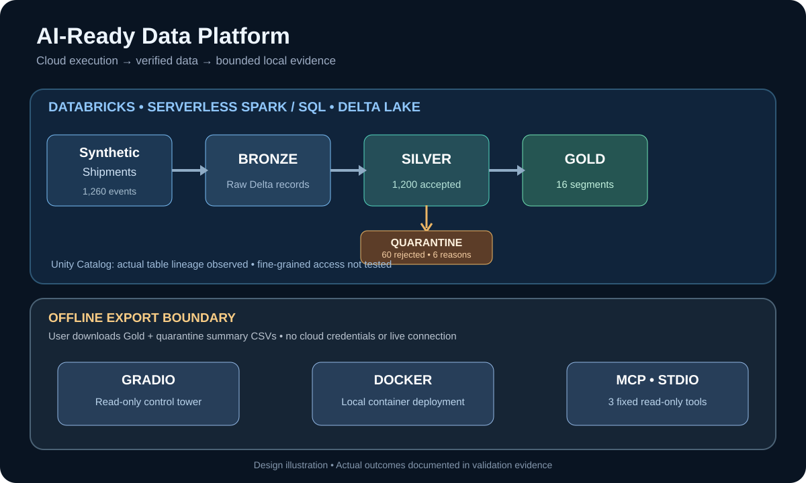

# Architecture and trust boundaries

**Cloud:** A user-run Databricks notebook builds synthetic supply-chain shipment records. PySpark and Spark SQL write Delta tables into `workspace.ai_ready_demo`. `sc_bronze` retains the raw records, `sc_silver` holds validated rows, `sc_quarantine` holds rejected rows and reason labels, and `sc_gold` provides regional/part-type aggregates. Unity Catalog recorded table-level lineage from Bronze to Silver to Gold. The notebook was also executed successfully as a manual serverless Lakeflow Job.

**Boundary:** The user manually downloads only the **Gold summary** and **quarantine reason count** tables as CSV snapshots. This is an offline data transfer. Unity Catalog permissions, audit logs, and lineage enforcement **do not follow** the CSVs. The local application does not query Databricks and needs no Databricks credentials.

**Local:** Gradio presents the two snapshots; Docker packages the same dashboard as a loopback-bound, non-root local service; the separate MCP stdio process exposes three bounded read-only operations over the named files. The MCP tools do not connect to Databricks, call a model, approve releases, or make changes.

**Data classification:** All source records are synthetic. The example business metrics are modeled demonstrations; they are not operational, audited financial, or production KPIs.
